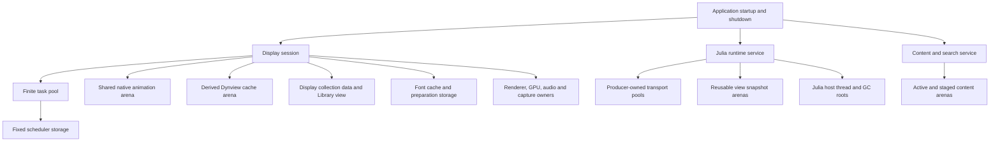
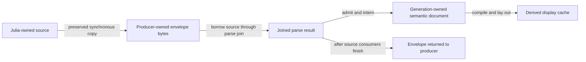

# Memory Architecture

> Euclid distributes memory management with runtime responsibility. Subsystems own
> storage whose allocator, access rules, and reclamation boundary match their work;
> queues, snapshots, and joins connect those lifetimes. This guide owns the memory
> architecture standard: the allocation and lifetime rules contributors must follow,
> the design direction they should preserve, and the runtime context behind both.

## Table Of Contents

1. [Purpose And Authority](#purpose-and-authority)
1. [Allocation And Lifetime Standard](#allocation-and-lifetime-standard)
   - [Choose Storage By Lifetime](#choose-storage-by-lifetime)
   - [Reusable Allocators](#reusable-allocators)
   - [Resource Capabilities And Effects](#resource-capabilities-and-effects)
   - [Allocation Source Visibility](#allocation-source-visibility)
   - [Initialize, Reuse, And Retire](#initialize-reuse-and-retire)
   - [Analyzer Policy And Exceptions](#analyzer-policy-and-exceptions)
1. [The Mental Model](#the-mental-model)
1. [Ownership Map](#ownership-map)
1. [Allocator Mechanisms](#allocator-mechanisms)
1. [Memory Domain Map](#memory-domain-map)
1. [Shared Animation Memory](#shared-animation-memory)
1. [Transport And Publication Lifetimes](#transport-and-publication-lifetimes)
1. [Derived Caches And Native Resources](#derived-caches-and-native-resources)
1. [Library And Persistence Memory](#library-and-persistence-memory)
1. [Julia Heap And Rooting Windows](#julia-heap-and-rooting-windows)
1. [Temporary Storage And Joined Work](#temporary-storage-and-joined-work)
1. [Shutdown And Reclamation Order](#shutdown-and-reclamation-order)
1. [Allocation Policy And Runtime Evidence](#allocation-policy-and-runtime-evidence)
1. [How To Investigate A Memory Question](#how-to-investigate-a-memory-question)
1. [Maintaining This Guide](#maintaining-this-guide)
1. [Official References](#official-references)

## Purpose And Authority

The package hierarchy describes dependency direction. It does not, by itself,
describe the application's memory topology: a display-owned object may lend storage
to a joined worker, several stores may share one generation arena, and a receiver
may consume a message without owning its allocation.

This document is the normative home for memory ownership, allocation, reuse, and
retirement. [Coding Standards](CodingStandards.md) delegates memory policy here;
[Architecture Summary](ArchitectureSummary.md) remains a descriptive entry point.
Read [Julia Thread Architecture](JuliaThreadArchitecture.md) for the host protocol.

**MUST**, **SHOULD**, and **MAY** have the meanings defined by
[Coding Standards](CodingStandards.md#how-to-read-this-standard). The standard below
governs new and changed code. Its **SHOULD** rules express the intended design
direction, not a claim that every existing subsystem has already converged on it.
Descriptive domain maps explain existing ownership; they do not establish
compliance with every normative rule.

Implementation and tests establish actual behavior; they do not waive the standard.
When they disagree with it, investigate the discrepancy and make the correction or
reviewed policy change explicit.

[Analysis settings](../../../tools/analysis_settings.jl) remain authoritative for
automated allocator classification, responses, and reviewed defenses. Follow the
precedence in [Coding Standards](CodingStandards.md#living-automated-policy):
safety, ownership, and ABI requirements first, then active automated policy, then
repository standards. These memory rules are review-enforced except where the
active analyzer or tests check them; describing a rule here does not add an
automated check. Automated exceptions belong in the existing settings, not in a
second ledger in this guide.

## Allocation And Lifetime Standard

Euclid uses initialization-first allocation in production: storage is established
at the boundary that knows its owner and lifetime, reused while that lifetime is
active, and released or reset by that owner. Steady-state frame and worker paths
SHOULD use bounded or preallocated storage rather than silently growing the
default heap. Initialization-first does not require reserving every feature's
maximum imaginable size at process startup.

### Choose Storage By Lifetime

Before adding an allocation, contributors MUST identify who owns it, who may mutate
it, how long it must remain valid, who reclaims it, and what happens if allocation
fails. The allocator SHOULD make those answers natural:

Euclid has one primary application heap root: `Euclid_General_State`. Fixed children
with the same lifetime SHOULD live as values directly in that stable owner and be
initialized in place; pointer-based interfaces do not require separate heap
allocations or redundant pointer aliases in the owner. Reachability from the root does
not make an independently lived worker, native resource, generation, or subsystem part
of the root's allocation domain. A separate domain is justified only when it provides
a real lifetime, bounded-capacity, reuse, or access contract; its owner and teardown
MUST be explicit.

Operation and frame scratch are temporary domains, not alternate persistent heaps.
Their contents MUST NOT escape the operation or frame reset. A long-lived object
MUST NOT retain `context.allocator` merely because it was available when the object
was initialized.

| Lifetime or use | Preferred storage | Required reasoning |
| --- | --- | --- |
| One operation | Caller-owned scratch or temporary storage | Do not retain it past its reset boundary. |
| Frame or task | Frame/task scratch or operation result storage | Reclaim only after consumers have joined. |
| Same-lifetime application state | Fixed storage in the primary application root | Initialize in place; avoid redundant context-backed siblings. |
| Subsystem | Owned allocator, pool, or arena | State the real owner, lifetime, and teardown. |
| Generation | Generation-owned storage, often arena | Detach borrowers before reset or replacement. |
| Process | Explicit process-owned storage | Initialize once; document intentional permanence. |
| Julia heap | GC-managed values and rooted handles | Root handles during native calls; distinct from Odin storage. |

The [mental model](#the-mental-model) distinguishes allocation ownership from access
permission; the [domain map](#memory-domain-map) identifies existing owners.

### Reusable Allocators

Contributors SHOULD prefer an existing allocator when its lifetime matches the data
instead of creating another pool or arena for each feature:

| Allocator | Intended use | Lifetime boundary |
| --- | --- | --- |
| `context.temp_allocator` | Operation/frame scratch | Invalidated at the temporary-storage reset |
| Shared animation arena | Native data needed for one active animation | Retire borrowers before generation reset |

The animation allocator is deliberately reusable across feature-level stores.
The animation-value store and Dynview document store are two existing larger
management schemes that borrow it; they do not make it exclusive to those
systems. New native data whose useful lifetime is exactly one animation
generation SHOULD use this allocator rather than introducing a parallel
generation arena. Its owner and generation contract MUST remain explicit, and
all borrowers and derived aliases MUST be detached before the shared reset.
The allocator API is [`animation_memory_allocator`](../../../src/core/animation/memory.odin);
its shared borrowers are coordinated in
[`animation_storage.odin`](../../../src/bridge/animation_storage.odin).

`context.temp_allocator` MUST be used only when data cannot escape its
operation/frame reset, never for generation-lived state. Frame scratch SHOULD NOT
be placed in the animation arena merely because that allocator is available.
Data that must outlive an animation generation, or has an independent subsystem
lifecycle, MUST use storage owned for that longer or separate lifetime.
See [Shared Animation Memory](#shared-animation-memory) and
[Temporary Storage And Joined Work](#temporary-storage-and-joined-work).

Production Odin code MUST pass an allocator explicitly at each direct allocation
site. It SHOULD use a dedicated allocator whose owner and lifetime match the
allocation. `context.allocator` is permitted only at a root/bootstrap allocation
or a specific, narrowly reviewed production exception for which the owner, need,
lifetime, matching release, and partial-initialization cleanup are explicit.
It is not a general-purpose backing allocator for reusable APIs or independent
subsystems. Contributors MUST NOT hide an allocation source by omitting the
allocator or changing it to an unowned default.

In tests, `context.allocator` is the normal choice for fixture allocations and
is preferred over artificial allocators. The analyzer intentionally ignores
context allocations in `*_test.odin`; use a reviewed
`ReviewedAllocationPolicy` only for a justified exception not covered by that
test-file rule. Tests MUST still use explicit allocation sites and matching
release. This fixture exception does not authorize context defaults or fallbacks
in shared production APIs.

### Resource Capabilities And Effects

Resource parameters and fields express authority to perform effects in a particular
domain, not merely implementation plumbing. Contributors MUST pass or retain an
allocator, resource owner, or managed-runtime handle only where its capabilities
serve the operation's contract. Availability alone is not a reason to propagate it
through another layer.

| Capability | Expressed authority and obligation |
| --- | --- |
| Borrowed allocator in an object | The object may acquire storage from that domain during its lifetime. The backing owner must remain valid through use and teardown; reclamation follows the domain's policy. |
| Writable destination slice | The operation may write within supplied storage. It does not acquire authority to grow or replace that storage. |
| SQLite connection or statement | The operation may affect SQLite-managed resources, subject to connection ownership and statement/text lifetimes. |
| Julia value or rooting interface | The operation may interact with Julia-managed values, subject to host-thread, rooting, and GC lifetime rules. A value handle alone does not establish a root. |

An explicit borrowed allocator is therefore more than encapsulated implementation
detail: it declares possible allocation effects and a dependency on an externally
owned domain. Passing the containing object can convey that capability without
repeating allocator parameters on every method. Procedures that may acquire or grow
storage MUST document that meaningful effect; a particular call need not allocate
for the capability contract to matter.

Contributors MUST NOT add native allocator capabilities merely because SQLite or
Julia may allocate internally. Those effects belong to their respective resource
domains and MUST be expressed through the appropriate interfaces and lifetime rules.
Conversely, an operation with no application-side allocation may still create,
mutate, or release managed resources; it must not be described as having no resource
effects.

For example, a SQLite text read can accept a statement and caller-owned destination
bytes, copy into that destination, and report a capacity error. It needs no native
result allocator. If growable storage is genuinely required, its owner decides how
to acquire it and supplies the resulting destination; the copy operation does not
inherit that owner's allocation policy.

Keep ownership policy at the boundary that establishes the domain and lifetime.
Lower layers SHOULD receive only the capabilities they need. Replacing an owner's
backing storage should not require changing buffer-only operations into
allocator-aware APIs. Odin's implicit context does not remove the obligation to
express meaningful effects and resource dependencies explicitly.

### Allocation Source Visibility

An allocator interface is a mechanism, not proof of ownership. Contributors MUST
keep the actual allocation source visible:

- Context-backed allocations MUST name `context.allocator` directly at the
  allocation site. Contributors MUST NOT introduce a field, local alias, or
  pass-through allocator parameter merely to disguise that source.
- An allocator field MUST represent ownership or management of a real custom
  domain, not cached ambient context or a subordinate's pass-through copy.
  An allocator parameter MUST express a genuine custom-domain or caller-selected
  storage contract. Production callers MUST NOT pass `context.allocator` through
  a helper merely to relay the default heap.
- Owner-backed initialization MUST use storage inherent to the owner. Initialize
  a fixed child through its owner, or pass the actual domain owner when a distinct
  custom domain is required; do not add a context-relay parameter to a subordinate
  initializer.
- An allocator parameter MUST NOT default to `context.allocator`. A required
  owner or allocator that is missing or invalid MUST take the subsystem's explicit
  failure path; it MUST NOT be replaced with ambient context or yield success-shaped
  behavior.
- Dedicated allocator owners MUST be initialized before use. Their consumers
  MUST use the owner's allocator directly, not silently fall back to
  `context.allocator` when the owner is absent or uninitialized.
- Failure to initialize or acquire required storage MUST follow the subsystem's
  explicit error/admission path. It MUST NOT change the allocation domain.
- Allocation and release MUST use compatible allocator state. When storage
  depends on a dedicated domain, its owner MUST retain reclamation authority
  until all borrowers have retired. A production context-backed exception MUST
  keep the matching allocator valid through release and document that lifecycle;
  caching ambient context in an unrelated object is not a substitute.

Scratch MUST remain visibly temporary, and pool-backed allocation MUST remain
traceable to its actual pool owner. Generic allocator plumbing MUST NOT be added
solely to change analyzer classification. These requirements apply in tests too;
tests MAY deliberately supply explicit allocators to allocator-taking helpers to
exercise allocation failures.

For example, this test fixture is explicit and reclaims from the same allocator:

```odin
state := new(core.Euclid_General_State, context.allocator)
defer free(state, context.allocator)
```

These production shapes do not establish ownership and MUST NOT be used:

```odin
allocator: mem.Allocator
object.allocator = context.allocator
init_subsystem(&state.subsystem, context.allocator)
allocator := owner.allocator
if allocator.procedure == nil {
    allocator = context.allocator
}
```

The field is invalid when it merely caches ambient context, and the initializer
argument is invalid when it only relays that default. Fixed children should use
their owner's storage; a genuinely independent domain should be initialized and
reclaimed by its actual owner.

### Initialize, Reuse, And Retire

- Known steady-state capacity SHOULD be reserved during initialization. Reuse
  the buffer or slot rather than rebuilding it on every frame or tick.
- Hot paths MUST NOT introduce hidden default-heap growth. Dynamic collections
  MUST have an intentional capacity and growth policy even where the analyzer
  does not classify each `append`, `reserve`, or `resize` call.
- Storage SHOULD be bounded when inputs, traffic, or operation duration can
  grow. Capacity exhaustion MUST have an explicit status, backpressure, retry,
  coalescing, or rejection policy; do not silently truncate or grow without bound.
- An arena reset invalidates every allocation from that arena. Owners MUST
  detach or retire all borrowed slices, pointers, and derived aliases before
  reset or destruction.
- Allocation and release MUST remain visible as a lifecycle pair. Partial
  initialization and failure paths MUST clean up only resources they acquired,
  and MUST leave the object in a documented usable or failed state.
- Event-driven allocations MAY be appropriate when the event is bounded and
  their owner and release point are explicit. They MUST NOT become accidental
  recurring frame/tick allocations.
- Borrowed slices, pointers, arena allocations, and generation-bound handles
  MUST NOT outlive their owners or validity boundaries.
- Process-scoped allocator instrumentation MUST restore `context.allocator`
  before reporting or destroying tracking metadata; runtime state may only borrow
  that domain.

The following are intentional patterns, not blanket exemptions:

- Frame-scoped scratch is valid until its reset; joined task results remain valid
  according to their storage owner's contract until consumed and reclaimed.
- Julia GC-managed allocations are appropriate inside Julia's ownership model.
  Native code MUST keep Julia handles rooted across calls that use them and
  copy Julia-owned bytes before their preservation window ends. See
  [Julia Heap And Rooting Windows](#julia-heap-and-rooting-windows).
- Dedicated arenas MAY grow within their explicit owner lifetime. Owners MUST
  reset only after borrowers are detached and destroy only after consumers have
  joined or stopped. Prefer the shared animation allocator for animation-generation
  data; use another subsystem arena only when its lifetime differs.
- Narrow event-driven output, such as completed GIF bytes, asset staging, or
  candidate font metadata, MAY allocate outside a continuous frame/tick path
  when bounded and reclaimed by a clear owner.

For the reasons behind these boundaries, see
[Transport And Publication Lifetimes](#transport-and-publication-lifetimes),
[Derived Caches And Native Resources](#derived-caches-and-native-resources), and
[Shutdown And Reclamation Order](#shutdown-and-reclamation-order).

### Analyzer Policy And Exceptions

The analyzer classifies Odin allocation sites by allocator source. An
unclassified allocation is a blocking analysis failure; contributors MUST use an
explicit, traceable allocator expression rather than relying on implicit defaults.
Dynamic-array mutators are treated separately because the collection carries its
allocator from creation; that classification does not waive the reuse and
bounded-growth rules above.

The parser-backed `ODIN-ALLOCATION-CONTEXT` check is blocking in the repository
analysis settings. It rejects context-backed allocator defaults, direct forwarding
of `context.allocator` through allocator-bearing calls, retained aliases, and
context-valued allocator fields. It also recognizes saved-context restoration
patterns so instrumentation can restore the process allocator without retaining
it as an unrelated domain.

These are syntax-backed checks, not proof of semantic ownership. Cross-procedure
provenance, allocator-field ownership, whether a separate domain has a justified
lifetime, and indirect patterns outside the check's recognized syntax remain
review-enforced. An accepted syntax or exact reviewed exception does not waive
the ownership contract above.

An exception that the analyzer must permit belongs in
`ReviewedAllocationPolicy` in [analysis settings](../../../tools/analysis_settings.jl),
with an exact site, reason, and expected match count. The policy is drift-checked.
Contributors MUST NOT add a broad suppression, weaken classification, or turn a
warning off without reviewing the allocation's actual owner and lifetime.
An exception MUST NOT legitimize a hidden context allocation, an uninitialized
owner, or a context fallback. Repair the ownership/source defect instead.
Changes to automated policy MUST update the settings and verify resulting analysis
behavior under the [verification gate](CodingStandards.md#verification-gate).
Runtime evidence and its limits are explained in
[Allocation Policy And Runtime Evidence](#allocation-policy-and-runtime-evidence).

## The Mental Model

Four questions are more useful than asking only which allocator a feature uses:

| Question | Architectural meaning |
| --- | --- |
| Who owns the storage? | Who provisions it and is responsible for its eventual release? |
| Who may access it now? | Which thread or operation may read or mutate it at this boundary? |
| What ends validity? | Individual free, frame reset, task join, generation retirement, or subsystem shutdown? |
| What backs it? | Ordinary allocator storage, virtual-memory reservation, fixed inline capacity, or a foreign runtime? |

Storage ownership and permission to access data are different. A producer can lend
an envelope to a receiver while retaining responsibility for freeing it. A worker
can temporarily mutate a cache whose lifecycle remains display-coordinated.

Likewise, a logical lifetime need not be a separate allocation. Shape and particle
records can be reset within persistent fixed storage. Conversely, one logical
animation generation has data in several physical domains: canonical arena storage,
bounded tick snapshots, transport payloads, and Julia objects.

Useful distinctions throughout this guide:

- **Owner:** coordinates allocation and reclamation, including partial startup.
- **Borrower:** uses storage without gaining the right to reset or free its owner.
- **Copy:** establishes bytes in a different lifetime; the source can then retire.
- **Ownership transfer:** explicitly hands responsibility to a new owner. Copying an
  owning struct containing pointers is not automatically such a transfer.
- **Retirement:** stops admitting new use and waits for existing consumers before
  reclamation. A changed generation number alone does not make old pointers safe.

Euclid has shared storage primitives, not one application-wide memory landlord.
Root [core](../../../src/core/core.odin) composes state; reachability from that
state does not make root core the owner of every reachable allocation.

## Ownership Map

This is a map of lifecycle responsibilities, **not a physical backing tree**.
An arrow means "coordinates this lifetime"; it does not mean that all child bytes
come from the parent's allocator. Detailed handoffs appear later.



The app also owns the user-data store admitted during startup. Its connection and
replay workspace are lent to serialized save work, not to arbitrary concurrent
display and worker access. The [domain map](#memory-domain-map) includes this
separate persistence lifetime.

## Allocator Mechanisms

Allocator choice follows reclamation needs. Similar allocator implementations do
not imply that their owners or lifetimes should be merged.

| Mechanism | Euclid use and contract | Official reference |
| --- | --- | --- |
| Explicit ordinary allocator | Direct allocations use an explicit allocator expression and paired release. `context.allocator` is limited to root/bootstrap or narrowly reviewed sites, not ambient backing for a reusable domain; it is not a promise that the backing is an uninstrumented system heap. | [Odin allocators](https://pkg.odin-lang.org/core/mem/#overview-allocators) |
| Temporary allocator | Thread-local operation or frame scratch that cannot escape its reset boundary. Display/Julia loops, task invocations, and catalogue requests reclaim their own scratch; see [Temporary Storage And Joined Work](#temporary-storage-and-joined-work). | [Odin context system](https://odin-lang.org/docs/overview/#implicit-context-system) |
| Growing virtual arena | Shared animation storage, view snapshot slots, content generations, and derived Dynview cache storage. Bulk reset invalidates all allocations. | [`core:mem/virtual`](https://pkg.odin-lang.org/core/mem/virtual/) |
| Static virtual arena | Bounded renderer staging and serialized font preparation. Reservation and commitment are distinct; fixed reservation does not mean every byte is initially committed. | [`core:mem/virtual`](https://pkg.odin-lang.org/core/mem/virtual/) |
| TLSF allocator | Reusable, individually freed variable-sized allocations: bridge messages, scheduler/service storage, and optional font metadata. | [`core:mem/tlsf`](https://pkg.odin-lang.org/core/mem/tlsf/) |
| Mutex allocator wrapper | Synchronizes allocator operations for the task pool and content service. It does not make allocated application objects safe for concurrent mutation. | [`core:mem`](https://pkg.odin-lang.org/core/mem/) |
| Tracking allocator wrapper | Debug allocation evidence around allocations routed through a tracked domain. Accounting is not ownership of the tracked objects' lifecycles. | [`core:mem`](https://pkg.odin-lang.org/core/mem/) |
| Inline arrays and retained buffers | Bounded worlds, slots, commands, queues, and reusable workspaces. Logical clearing often changes counts rather than allocating or freeing. | [Odin arrays and slices](https://odin-lang.org/docs/overview/) |

The repository's owned storage wrappers deserve separate attention:

- [`Arena_Owner`](../../../src/core/storage/arena_owner.odin) owns a growing virtual
  arena, publishes its allocator, and retains lifecycle diagnostics. Reset retains
  the first block and releases growth blocks; destruction releases the arena.
  Used, reserved, and committed bytes are separate measurements. The initialized
  owner must remain at a stable address and must not be copied.
- [`TLSF_Owner`](../../../src/core/storage/tlsf_owner.odin) retains stable TLSF
  controls, backing-pool records, and aligned pools for individually reusable
  allocations. Its caller supplies the real backing allocator domain, which must
  outlive the owner; every pool and record is released through that same allocator.
  Growth admits a pool only after its metadata, backing, and TLSF initialization
  succeed, and sizes pools for TLSF's mapping slack as well as the request.
  Allocation, free, resize, diagnostics, and destruction belong to one owner
  thread; the initialized owner must remain at a stable address and must not be
  copied. Failed replacement leaves the previous allocation valid.

An arena is a good fit when data dies together. A reusable free-list allocator is
a better fit when independently edited objects die at different times. Neither
removes the need for checked admission, stable owner addresses, or safe retirement.

## Memory Domain Map

These are architectural domains, not an exhaustive allocation-site inventory.
Exact quotas and byte sizes belong to the linked models and implementations.

| Domain | Owner and storage | Reclamation or reuse boundary | Start reading |
| --- | --- | --- | --- |
| Application composition | One heap-allocated `Euclid_General_State` root with same-lifetime fixed children, including input, focus, projection, surface, shape world, and particles | Stop/join dependent services, then release the root once | [Core state](../../../src/core/core.odin), [runtime initialization](../../../src/view/runtime_session.odin), [shutdown](../../../src/view/shutdown.odin) |
| Shape world and particles | Canonical world and bounded particle state are inline in the application root; existing pointers address stable root fields | Logical scene resets reuse capacity; the root is released after simulation workers stop | [Shape System](ShapeSystem.md), [Particle System](../../../src/particles/), [runtime initialization](../../../src/view/runtime_session.odin) |
| Display input and semantic focus | Fixed input history and semantic-focus state are inline in the application root and borrowed by display UI paths | Reuse through the display session; root release invalidates both after the loop ends | [Input runtime](../../../src/view/input/runtime.odin), [UI model](../../../src/view/ui/model/model.odin) |
| Animation-generation data | Shared `Animation_Memory` arena, borrowed by values, documents, and production Terminal state | Detach borrowers, reset once, publish new generation | [Animation storage](../../../src/bridge/animation_storage.odin), [Terminal lifecycle](../../../src/view/terminal/lifecycle.odin) |
| Interface/catalogue materialization | Per-interface registry arena and stable interface slots | Retire or roll back interface generation; destroy at shutdown | [Bridge bootstrap](../../../src/bridge/bootstrap.odin) |
| Content/search | Dedicated service TLSF storage plus separately owned active/staged content arenas | Transactional generation replacement; stop worker before service release | [Content service](../../../src/view/content/service.odin), [content model](../../../src/core/content/model.odin) |
| Bridge channel and pool backing | One Julia-service-owned growing arena backs both links' channel buffers and TLSF backing slices | Join the worker, drain returned envelopes, destroy both links, then release the arena | [Runtime service](../../../src/bridge/runtime_service.odin), [arena owner](../../../src/core/storage/arena_owner.odin) |
| Bridge envelopes and nested bytes | Separate producer-owned fixed TLSF pools with bounded outbound/return channels | Receiver returns envelope; producer reclaims it | [Communication links](../../../src/bridge/communication_link.odin) |
| Tick and lifecycle work | Service-owned reusable slots, pointer-free query snapshots, staged writes and scene commands | Completion accepted or rejected before slot reuse | [Runtime model](../../../src/bridge/model/runtime.odin), [runtime service](../../../src/bridge/runtime_service.odin) |
| View snapshots | Per-slot growing arena and bounded payload builders | Only a free slot can reset; publication consumers must finish first | [Snapshot model](../../../src/bridge/model/model.odin), [runtime service](../../../src/bridge/runtime_service.odin) |
| Dynview derived cache | Dedicated cache arena and persistent shaping workspaces | Rebuild under exclusive worker access, then joined display use | [Simulation executor](../../../src/view/simulation/simulation_executor.odin), [compiler](../../../src/dynview/compile/compile.odin) |
| Task scheduler | Fixed virtual backing, mutex-wrapped TLSF, retained workers/queues/slots | Join task results and fences; stop pool before backing release | [Task pool](../../../src/taskpool/taskpool.odin) |
| Fonts | Cache-owned metadata TLSF for canonical glyphs, optional-raster records, and visible-ink samples; separate static preparation arena and display-owned atlas resources | Join preparation; copy/publish accepted data; release generation metadata on retirement and destroy cache storage after all consumers stop | [Font Rasterization](FontRasterization.md), [font cache](../../../src/view/font/font.odin) |
| Collections and Library | Display-owned TLSF records and stable UI nodes, optional copied labels, UUID indexes, and an independent Store replay owner | Same-generation edits patch only affected nodes; display and replay Sets own separate TLSF domains and are deep-copied between owners | [Collections](../../../src/collections/model.odin), [Library projection](../../../src/view/ui/model/tree_projection_storage.odin), [Library section](#library-and-persistence-memory) |
| User-data persistence | App-owned store, sequentially owned SQLite connection/statements, operation-scoped replay snapshots | Join save work before payload reuse or connection/store close; reclaim scratch at its operation boundary | [User-data model](../../../src/userdata/model.odin), [save coordinator](../../../src/view/preferences/settings_save.odin) |
| Terminal graphics and shell | Display-lifetime service owners, generation-bound attachments, joined jobs, native process resources | Unbind/close generation consumers before reset; stop services before pool destruction | [Graphics service](../../../src/view/terminal/service/terminal_graphics_service.odin), [shell service](../../../src/view/terminal/service/shell_service.odin) |
| Renderer and capture | Fixed CPU staging, SDL GPU resources, framebuffer owner, capture-owned GIF arena, native encoder, and output transaction | Reuse staged pixels within a capture; close/abort native work before resetting storage; retain published path until capture policy copies it | [Draw runtime](../../../src/view/native/sdl_draw_runtime.odin), [capture backend](../../../src/view/capture/backend/sdl_gif_capture.odin), [GIF encoder](../../../src/view/native/sdl_gif_encoder.odin) |
| Julia runtime | Ordinary Julia GC heap, rooted runtime host and active/candidate generations | Reachability and GC, plus explicit host shutdown; not Odin arena reset | [Julia host bridge](../../../src/bridge/runtime_service.odin), [Julia section](#julia-heap-and-rooting-windows) |

## Shared Animation Memory

[`Animation_Memory`](../../../src/core/animation/memory.odin) is a reusable native
generation allocator, not an allocator exclusive to one feature.

The animation-value store holds schema-qualified opaque payloads. The Dynview
document store holds generation-scoped authored semantic data. Both borrow the
same arena. Production Terminal initialization also obtains its allocator from
this owner for history, retained text, grids, checkpoints, and related state.

The shared lifetime is deliberate: feature stores retain their own contracts and
indexes while native data that expires with the animation can retire together.
Do not introduce a parallel animation-generation arena merely because a new
feature has its own model.

Generation replacement is an ordered operation:

1. Quiesce outstanding animation/presentation work and retire generation-bound
   services and aliases, including Terminal consumers where active.
1. Clear the value and document-store borrowers.
1. Reset the shared arena once.
1. Publish the new nonzero generation to the stores and initialize new borrowers.

[`animation_storage_begin_generation`](../../../src/bridge/animation_storage.odin)
coordinates the shared stores; it is not by itself a universal shutdown routine
for every consumer. Lifecycle coordination also lives in
[animation transitions](../../../src/bridge/animations.odin) and the
[presentation runtime](../../../src/view/presentation/presentation_runtime.odin).

An old pointer is invalid after reset even if the arena retains the same backing
block. Generation identities reject stale operations; they do not extend a
pointer's lifetime.

## Transport And Publication Lifetimes

### Producer-owned messages

The Julia runtime service owns one arena for both communication links' channel
buffers and TLSF backing slices. Each
[communication link](../../../src/bridge/communication_link.odin) retains its own
fixed TLSF pool within that backing arena. The producer allocates an envelope and
any nested bytes from its pool, sends it, and later drains returned messages. The
receiver borrows the envelope and returns it rather than freeing from the
producer's unsynchronized allocator.

The channels synchronize transfer. They do not authorize both threads to allocate
from the same raw TLSF pool concurrently, and the shared arena is used only during
service setup and teardown, not for concurrent message allocation. Stop and join
the worker and reclaim returned envelopes before destroying either link; release
the shared arena only after both links are destroyed. Queue capacity and pool-byte
capacity are separate limits, and both participate in admission.

The service object and its copied asset-root configuration use the explicit
bootstrap allocator retained by the service for matching teardown. The communication
arena has a separate owner and is released after worker join, returned-envelope
draining, and link destruction.

### A copy can establish the next lifetime

For Julia-produced presentation source, the broad path is:



This diagram describes data dependencies, not a transfer of one allocation through
all stages. Julia source, envelope bytes, parser output, semantic storage, and
derived layout have different owners.

The [presentation runtime](../../../src/view/presentation/presentation_runtime.odin)
retains an active envelope across asynchronous parsing and keeps one newest pending
replacement. Its durable parse-result storage survives display frames; frame
scratch would be inappropriate. Cancellation or supersession does not authorize
reclaiming a payload while a worker still reads it.

### Reusable slots are independent domains

Tick slots carry immutable query data and staged commands. Julia animation ticks
read packed value snapshots and stage value writes rather than freely reading or
mutating the canonical animation arena. Completion validation gates the native
commit.

View snapshot slots have their own arena-backed builders and sealed payloads.
Their arena resets only after the slot is free, not whenever an animation arena
resets. The consumer-facing payload is native-owned and does not require retained
Julia heap pointers. See the [bridge models](../../../src/bridge/model/) and
[slot preparation/publication](../../../src/bridge/runtime_service.odin).

## Derived Caches And Native Resources

### Dynview separates source lifetime from rebuild lifetime

Generation-owned semantic documents are not the same storage as compiled layout.
The [simulation executor](../../../src/view/simulation/simulation_executor.odin)
creates the Dynview cache arena and persistent shaping workspaces. The
[compiler](../../../src/dynview/compile/compile.odin) resets derived storage under
its rebuild-access contract; display reads resume after the preparation join.

This permits layout to change without replacing authored semantic storage. It also
means that a pointer into a previous layout is not valid merely because the
animation generation has not changed.

### Font preparation, cache retention, and GPU residency differ

The [font preparation service](../../../src/view/font/async.odin) serializes work
through a static virtual arena. Completion joins the worker before the arena can
reset. Accepted results must be consumed or copied into their retained owners
before that reset.

The [font cache](../../../src/view/font/font.odin) owns one bounded metadata TLSF
domain for canonical glyph records, optional-raster metadata, and visible-ink
samples. The domain has separate canonical-generation, optional-raster, and
visible-ink budgets; optional pressure may retire optional records but cannot
consume required canonical capacity. The preparation arena remains separate,
and math-font source bytes use operation scratch because HarfBuzz copies them.
GPU atlas admission and retirement are accounted independently from CPU
metadata. See [Font Rasterization](FontRasterization.md) for the publication path.

### Native allocations are not all Odin allocations

The [SDL draw runtime](../../../src/view/native/sdl_draw_runtime.odin) has fixed
arena-backed CPU staging and separately owned GPU buffers, textures, transfer
buffers, and pipelines. SDL, graphics drivers, FreeType, HarfBuzz, SQLite, and Julia
may also allocate internally.

The [capture backend](../../../src/view/capture/backend/sdl_gif_capture.odin)
owns a growing arena for transaction paths and native staged pixels. The encoder
closes or aborts before the arena is reset; a completed transaction path remains
valid while capture policy copies it into its fixed status buffer, then can be
reclaimed at the next capture or unbind. Atomic publication leaves completed GIF
files intact when their temporary path storage is reclaimed. [Audio](../../../src/view/native/sdl_audio.odin)
owns native stream resources on the display thread. These resources require
their native lifecycle APIs; resetting an Odin arena is not their destructor.

## Library And Persistence Memory

The [collection model](../../../src/collections/model.odin) stores actual-sized
collection and placement arrays, UUID indexes, and optional names in a TLSF domain
owned by each initialized `Set`. `Set` is not a freely copyable value: callers
transfer data with `clone`, and each initialized owner must be destroyed exactly
once. Optional custom and canonical labels are separately owned; canonical labels
are copied from the active catalogue generation and refreshed when that generation's
projection is replaced. A placement view borrows those bytes only for the query's
immediate consumer.

The display owns the editable collection `Set` and its
[Library UI projection](../../../src/view/ui/library/). The projection allocates
each tree node and copied canonical label from its own TLSF owner; a growable pointer
table and UUID index may move without relocating live nodes. Same-generation
membership and order changes patch topology in place, while names resolve through
the current collection owner. Catalogue changes are built in a staged projection and
replace the live tree only after the complete candidate succeeds. A mutation is
admitted against the display owner after pending/in-flight save capacity and tree
resources are reserved; it does not stage or replace a complete collection snapshot.
The bounded immutable mutation crosses to persistence, while frame scratch and
borrowed placement views must not escape their operation.

The projection also owns typed reusable frame rows, independent scratch rows,
motion branches, reorder rows, and iterative traversal frames. These buffers grow
with actual catalogue demand, not a fixed node ceiling. Preliminary preparation
is discarded before a projection mutation or replacement. Final preparation is
borrowed by semantic publication, pointer handling, drawing, and the final scroll
decision in that frame; the next preparation may overwrite it only after those
consumers finish. Scratch queries do not overwrite frame rows. Stable node identity
does not make a row pointer valid after workspace growth.

Search has a separate display-owned TLSF domain with accepted and staging
visibility-ID buffers. Admission failure retains the accepted result, and only a
complete result exchanges the buffers. Projection, search, and semantic snapshot
domains are destroyed during display shutdown.

Each semantic focus slot owns actual-sized node, UTF-8, identity-index, and
traversal-index buffers in its own TLSF domain. The owner header is not a copyable
snapshot value. Registration admits node/index/text growth before copying a node;
rejection leaves the committed slot authoritative. Identity and hierarchy checks
use complete qualified IDs and reusable indexes; parent-cycle validation and tree
publication are iterative. Text lengths, tree facts, and traversal order use checked
32-bit representation rather than the former fixed capacities and 16-bit widths.
Only populated logical content affects publication generation; retained capacity
and diagnostic work counters do not. Offscreen expanded nodes remain in the logical
semantic tree with clipped bounds, while outgoing visual-only rows have no actions.

Persistence has a separate consumption lifetime:

- A bounded immutable mutation batch crosses to save work; the worker does not
  borrow the display's mutable collection state.
- [Durable replay](../../../src/userdata/collections.odin) loads a separate
  Store-owned TLSF `Set`, backed by the explicit runtime heap allocator. It is
  reused to validate and apply the batch, persists it within the database
  transaction, and is destroyed when the Store closes. Launch deep-clones the
  loaded replay into the display owner; the display never retains the replay
  allocator or records.
- The save coordinator joins outstanding work before reusing its payload or
  closing the sequentially accessed user-data store.

The [SQLite boundary](../../../src/sqlite/model.odin) owns connection and
statement handles, not display collection data. SQLite column bytes are copied
into snapshot storage rather than retained past statement validity.

Collection snapshots, display projection, semantic publication, and native
callback storage have distinct validity contracts. A logical identity does not
extend a borrowed pointer's lifetime. Callback-safe publication and retirement
remain the responsibility of
[accessibility publication](../../../src/accessibility/publication.odin), not
permission for callbacks to retain mutable display storage.

## Julia Heap And Rooting Windows

### Ordinary Julia GC remains active

Julia objects live under Julia's collector, not under the native animation arena.
The official [GC overview](https://docs.julialang.org/en/v1/devdocs/gc/) describes
a non-moving, generational, mostly precise mark-sweep collector with parallel and
partially concurrent work. Julia uses pool allocation for small objects and a
different allocation path for larger ones. Those are runtime implementation
details, not Euclid allocator budgets.

Reachability determines collection eligibility. Losing a root does not mean
immediate reclamation, nor does collection imply an immediate matching drop in
process resident memory. A non-moving collector still requires rooting: an
unreachable object's address can become invalid through reclamation.

Only the Julia host thread enters libjulia. That rule does not imply Julia has no
internal runtime/GC threads or that Julia execution is free of collection pauses.

### The captured window is a rooting window

In [runtime service](../../../src/bridge/runtime_service.odin), a worker-lifetime
GC frame roots the Julia runtime host. The frame is installed before host creation
and restored during finalization. The Julia host's object graph retains its active
runtime generation and actor state.

Per-call frames separately root boxed arguments and temporary values during
Terminal ingress, animation ticks, and lifecycle calls. Reload candidates have a
local root through validation and commit or rollback in
[animation lifecycle code](../../../src/bridge/animations.odin).

These native frames use the Julia embedding GC-stack ABI through
[Julia bindings](../../../libs/julia/bindings/). They implement the rooting
discipline explained by Julia's
[embedding memory-management documentation](https://docs.julialang.org/en/v1/manual/embedding/#Memory-Management);
they are not an independent garbage collector. Frame layout and root encoding are
version-sensitive embedding details, not a portable API for feature modules.

Julia-side raw-pointer use has a corresponding preservation window:
[`GC.@preserve`](https://docs.julialang.org/en/v1/base/base/#Base.GC.@preserve)
keeps source or destination objects alive while a synchronous native copy uses
their addresses. See [animation wrappers](../../../src/julia/bridge/animations.jl)
and [presentation wrappers](../../../src/julia/bridge/presentation.jl).
Preservation does not transfer ownership or authorize native retention after the
protected operation.

Rooting is not GC suspension. There is a narrow exception-reporting path in
[bootstrap](../../../src/bridge/bootstrap.odin) that temporarily disables GC and
restores its previous state; startup/root validation and reload rollback also
contain explicit full collections. Those exceptional operations should not be
mistaken for a per-frame GC-off policy.

### Native animation values are copies, not migrated Julia objects

[`AnimationKey{T}`](../../../src/julia/bridge/animations.jl) names a schema-qualified
native value. The set/get wrappers require `isbitstype(T)`, enforce payload bounds,
and preserve `Ref{T}` storage while the bridge copies bytes:

1. Julia constructs a value in its ordinary ownership model.
1. Set copies its representation into native generation storage, or into staged
   writes when executing a tick.
1. Get copies from the active query snapshot/staged writes or canonical native
   storage into Julia-owned destination storage.
1. The native generation reset invalidates native stored values; Julia values
   already copied out remain subject to their own ordinary Julia lifetimes.

The [native exports](../../../src/bridge/abi-animations.odin) never retain the
Julia source/destination pointer. This is not a general serializer for arbitrary
Julia object graphs, and it does not redirect Julia allocations into Odin.
`isbits` is a representation constraint, not proof that a raw address encoded in
a value is safe to retain across lifetimes.

See Julia's [`isbitstype`](https://docs.julialang.org/en/v1/base/base/#Base.isbitstype),
[`Ref`](https://docs.julialang.org/en/v1/base/c/#Core.Ref), and
[C interface guidance](https://docs.julialang.org/en/v1/manual/calling-c-and-fortran-code/)
for the language mechanisms. The application's schema, key, quota, and generation
rules are defined by the [native value store](../../../src/core/animation/value_store.odin).

## Temporary Storage And Joined Work

Temporary allocation is intentionally convenient, but still has an owner and an
invalidation boundary.

Repository threads started through `core:thread` without an explicit initial
context receive a default context with their own thread-local temporary arena.
Odin destroys that arena at thread exit, but persistent workers still need
operation-level reclamation. A display-frame reset does not reclaim another
thread's scratch. Copying a context is shallow: it preserves allocator references,
not independent arenas. The Julia bridge saves its callback context on the Julia
owner thread; restoring that context does not create a new scratch lifetime.

| Owner | Reclamation boundary | Preservation contract |
| --- | --- | --- |
| [Display frame](../../../src/view/frame.odin) | Frame completion | Frame consumers must finish before the reset. |
| [Julia host](../../../src/bridge/runtime_service.odin) | Host-loop iteration | Native callbacks use the host context; no scratch may escape to later Julia work or messages. |
| [Task invocation](../../../src/taskpool/taskpool.odin) | Procedure return, before completion publication | Rewind only task allocations; preserve scratch already owned by an owner thread helping the pool. |
| [Catalogue SQLite owner](../../../src/view/content/worker.odin) | Startup admission and every completed request, including controls and failures | Database statements and sealed generations must not retain request scratch. |

"Valid until the next display frame" is not a universal promise. A message,
queued job, retained UI label, Julia task, or native callback MUST NOT keep a
pointer into scratch that can reset before consumption. Longer-lived data must
be copied into its owning payload, generation, or subsystem storage.

The [task pool](../../../src/taskpool/taskpool.odin) provisions fixed scheduler
storage before startup. Task payloads and result storage have their own owner
contracts; submitting a pointer does not make the scheduler own its pointee.
The allocator used to create a thread handle owns that handle, not the worker's
default context. Task execution substitutes a nil ordinary allocator to prohibit
an ambient task heap; this does not disable `context.temp_allocator`.

Task execution requires the executing thread's default temporary allocator.
Its scope preserves pre-existing caller scratch even when waiting or draining
executes Helpable work on the owner thread. Unconditional whole-arena reset in
that shared execution path would invalidate the caller's allocations. The scope
also handles an initially blockless arena and restores used-byte accounting when
Odin's scope rewind frees overflow blocks. A dedicated catalogue worker, in
contrast, can reset its whole arena after each request because persistent state
uses independent storage. Query coalescing does not extend that lifetime across
control requests.

A task join establishes that the worker no longer accesses its payload/result
storage. Scratch has already expired before the completion is published, so
joined results MUST use independently owned storage. Joining does not
automatically free that storage. Owners then consume, publish, reset, or release
it. Requesting cancellation is neither a join nor a scratch reset; all ordinary
task return outcomes reclaim scratch.

The [task-pool regressions](../../../src/taskpool/taskpool_test.odin) verify cold
start, repeated task outcomes, overflow-block reclamation, and preservation of
owner-helping scratch. The [catalogue regressions](../../../src/view/content/scratch_test.odin)
observe resets during startup, failed admission, and control-only staging before
checking published results. These assert used-pressure reclamation, not zero
retained backing capacity or a latency budget.

## Shutdown And Reclamation Order

Shutdown follows dependencies, not a sweep over every allocator:

- Flush and join settings/collection saves before closing their borrowed store.
- Join font preparation and stop resource consumers before destroying font storage.
- Stop generation-bound Terminal graphics/shell consumers before retiring their
  parser, attachment, and animation storage.
- Quiesce presentation and Julia work before reclaiming envelopes, snapshot arenas,
  host bindings, or generation storage.
- Join task-pool users before destroying scheduler backing and persistent worker
  workspaces.
- Destroy native GPU/audio resources while their native owners are still valid.
- Release session objects only after their services stop borrowing them.

This is a dependency checklist, not an alternative literal call sequence.
Concrete ordering and partial-startup cleanup live in
[runtime session teardown](../../../src/view/runtime_session.odin),
[window shutdown](../../../src/view/shutdown.odin),
[window-session ownership](../../../src/view/window_session.odin), and
[application launch](../../../src/app/launch.odin).

The debug [process allocation envelope](../../../src/main.odin) restores the original
allocator before reporting and destroying its tracker. Destroying tracker metadata
does not clean up leaked backing allocations. An allocator destructor cannot
substitute for stopping outstanding consumers.

## Allocation Policy And Runtime Evidence

Three complementary views exist:

| View | Answers | Does not establish |
| --- | --- | --- |
| Static allocation policy | Which sites and allocator sources are admitted, with what reviewed defense? | That every runtime lifetime is correct or every workload is allocation-stable |
| Runtime counters and scenarios | What measured ownership/pressure changed under this exercised workflow? | Complete process/GPU/Julia heap accounting |
| This memory standard and architectural guide | Required ownership/lifetime contracts, intended design direction, and why domains and handoffs exist | Automatic enforcement of every rule or an automatically extracted heap graph |

### What the existing evidence measures

[`evidence/allocation`](../../../src/evidence/allocation/allocation.odin) wraps selected
Odin allocation paths with `mem.Tracking_Allocator`. Snapshots include live
allocations, current bytes, peak bytes, cumulative allocation count, and bad frees.
Restoration checks compare live allocation count, current bytes, and bad-free count;
cumulative totals and peaks are not expected to decrease.

The debug process tracker observes allocations routed through its allocator.
Direct virtual-memory reservations, foreign heaps, and GPU allocations are not
automatically included. Even when it sees a backing buffer, it need not see every
suballocation from the allocator layered over that buffer.

Scenario arena checkpoints currently name exactly three domains:

- `animation`: the shared animation arena.
- `snapshot_slots`: aggregate diagnostics for the service's view snapshot arenas.
- `display_cache`: the derived Dynview cache arena.

The [scenario adapter](../../../src/view/scenario/scenario_runtime.odin) samples at
owner-controlled boundaries. Arena comparisons require matching current usage,
reservation, commitment, initialized count, and sampled lifetime high waters;
reset counts may advance. Snapshot-slot peak aggregation sums per-arena sampled
peaks, not necessarily a simultaneously observed process-wide peak.

[`allocations.json` generation](../../../src/evidence/artifact/artifact.odin) preserves
arena checkpoint and assertion-time observations. Combine those with scenario
result/completeness, semantic events, and the exercised workload; an unchanged
counter alone does not prove correct rendering or publication.

The bundle also records separate Library TLSF domains through the
[display adapter](../../../src/view/evidence/library_storage.odin). Replay is sampled
only after saves join; retained free-list backing is not an arena checkpoint.

### How to read the numbers

- **Used/requested bytes** describe logical allocator pressure, not necessarily
  all allocator metadata or all physical memory.
- **Retained backing** can stay high after individual frees because a pool remains
  available for reuse.
- **Reserved virtual bytes** are not the same as committed bytes or resident pages.
- **Sampled arena peaks** are high waters observed by owner diagnostics, not a
  continuously traced measurement of every intermediate allocation.
- **No bad frees** means none were reported through those trackers; it is not a
  universal use-after-free or stale-pointer detector.

Do not add a parent's backing reservation to its children's used bytes and call
the result total memory: these can be different views of the same storage.
Similarly, animation-value diagnostics that include their shared arena are not
additional arena backing beyond `Animation_Memory`.

## How To Investigate A Memory Question

| Symptom or question | First distinction to make |
| --- | --- |
| Memory grows after repeated edits | Live records/text versus reusable retained pools; include warm-up and repeated same-shape workloads |
| Stale data after reset/reload | Storage validity versus generation identity; inspect borrowers and completion rejection |
| Stable animation arena but rising process memory | Separate caches, transport, foreign heaps, GPU resources, and retained runtime/JIT storage |
| Allocation failure despite low live bytes | Pool capacity/fragmentation, admission quota, alignment, or failed backing acquisition |
| UI/presentation corruption across frames | A retained pointer into frame scratch or a prematurely reused slot/envelope |
| Shutdown allocation mismatch | A still-running consumer, missing owner teardown, or tracking metadata/backing confusion |
| Need a new allocator | Does data have a genuinely different reclamation boundary, or can it use an existing owner? |

Trace allocation, publication, final consumption, and reclamation as separate
steps. Identify the owner at each step before changing allocator choice.
For ordering-sensitive behavior, use [semantic scenarios](TestingStrategy.md);
for timing, use profiling evidence rather than treating allocation counters as
latency measurements.

## Maintaining This Guide

Update this map when adding or changing a meaningful ownership domain, backing
strategy, cross-thread borrowing contract, or reset/destruction boundary.
Ordinary allocation-site edits need not grow this document.

Keep normative memory rules, rationale, and relationships here; keep exact limits
and implemented lifecycle behavior in models/tests, reviewed defenses in
[analysis settings](../../../tools/analysis_settings.jl), and subsystem protocols
in their specialist guides. Changes to memory contracts MUST update this guide
and the affected implementation/tests together. Standards changes SHOULD identify
their rationale, scope, exceptions, enforcement, and migration as described in
[Standard Updates](CodingStandards.md#standard-updates). Do not duplicate this
standard in Coding Standards or present intended designs as implemented guarantees.

For publication, authored guides are listed in the
[wiki manifest](../../../tools/code_wiki.toml), as described by
[Wiki Composition](WikiComposition.md). Authored policy and generated wiki output
have separate lifecycles; generated pages do not replace the source standard.

## Official References

These explain upstream mechanisms; Euclid's ownership and admission contracts
remain repository-specific. The versioned toolchain used by the build takes
precedence over details in rolling upstream documentation.

| Topic | Reference |
| --- | --- |
| Odin allocator interfaces, memory helpers, tracking and mutex wrappers | [`core:mem`](https://pkg.odin-lang.org/core/mem/) |
| Odin virtual memory, growing/static arenas, reset and destruction | [`core:mem/virtual`](https://pkg.odin-lang.org/core/mem/virtual/) |
| Odin TLSF implementation | [`core:mem/tlsf`](https://pkg.odin-lang.org/core/mem/tlsf/) |
| Odin implicit context and allocators | [Context system](https://odin-lang.org/docs/overview/#implicit-context-system) |
| Julia collector design and allocation strategy | [Garbage Collection in Julia](https://docs.julialang.org/en/v1/devdocs/gc/) |
| Native embedding and rooted Julia handles | [Embedding: Memory Management](https://docs.julialang.org/en/v1/manual/embedding/#Memory-Management) |
| Keeping Julia objects alive during pointer use | [`GC.@preserve`](https://docs.julialang.org/en/v1/base/base/#Base.GC.@preserve) |
| Reference storage and pointer conversion | [`Ref`](https://docs.julialang.org/en/v1/base/c/#Core.Ref), [C interface](https://docs.julialang.org/en/v1/base/c/) |
| Julia plain-data representation constraint | [`isbitstype`](https://docs.julialang.org/en/v1/base/base/#Base.isbitstype) |
| Julia/native argument conversion and GC safety | [Calling C and Fortran Code](https://docs.julialang.org/en/v1/manual/calling-c-and-fortran-code/) |
